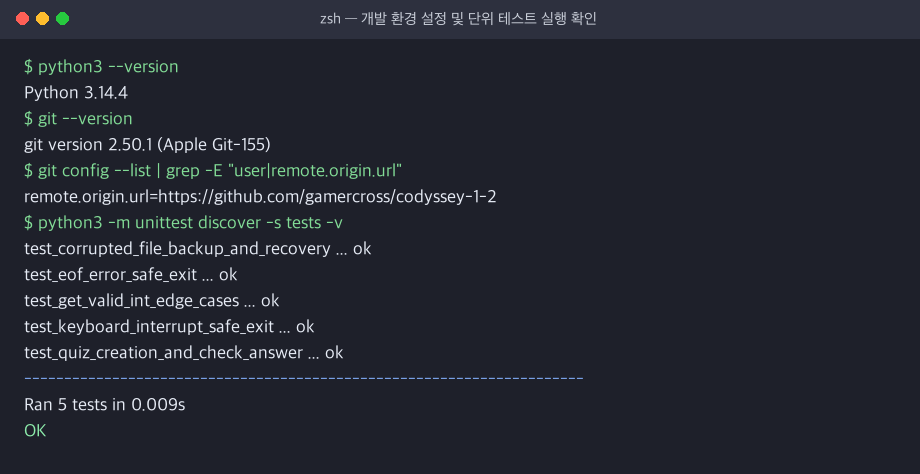
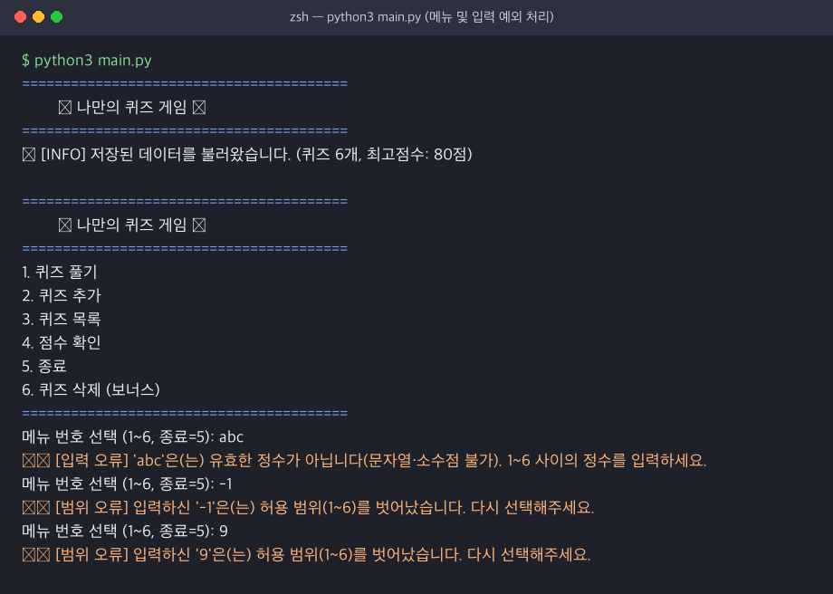
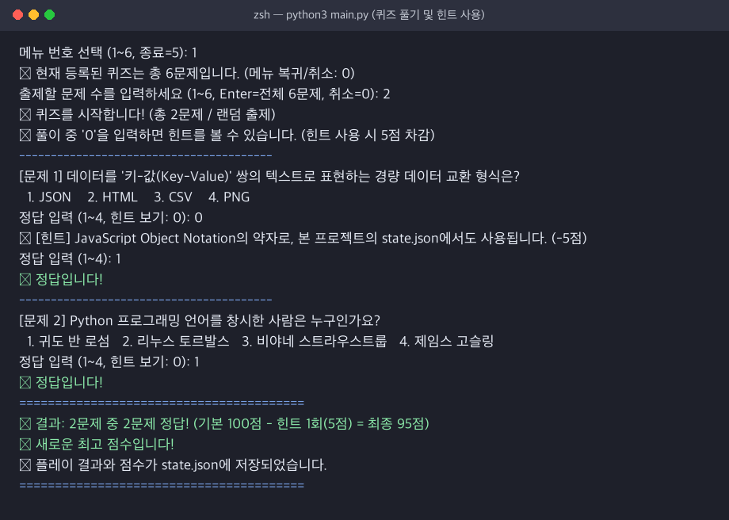
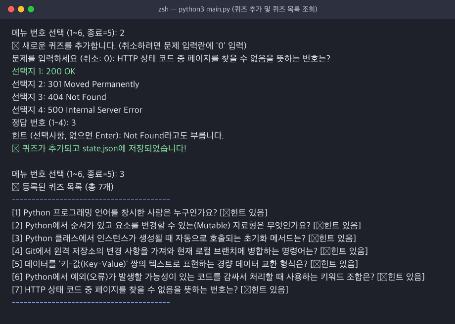
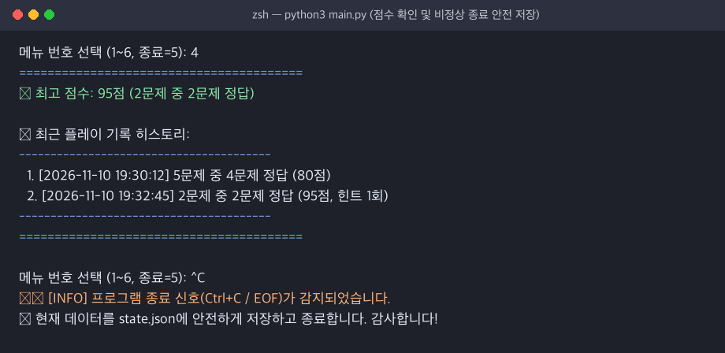
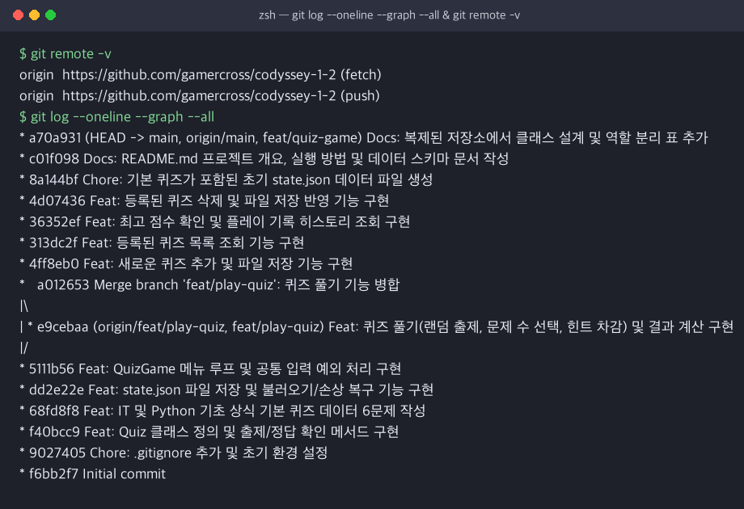
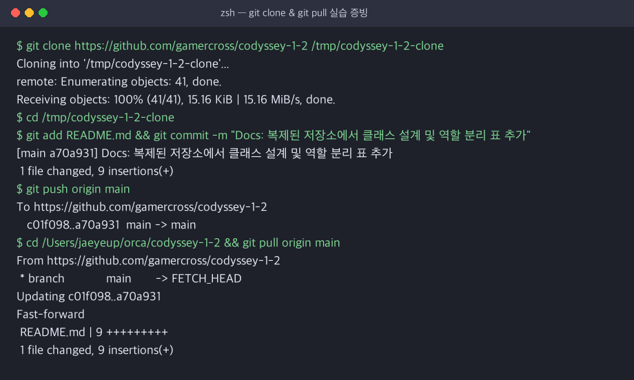

# 🎯 나만의 퀴즈 게임 (IT & Python 기초 상식 퀴즈)

- **GitHub 원격 저장소 URL**: [https://github.com/gamercross/codyssey-1-2](https://github.com/gamercross/codyssey-1-2)
- **GitHub Pull Request URL**: [https://github.com/gamercross/codyssey-1-2/pull/1](https://github.com/gamercross/codyssey-1-2/pull/1)

---

## 1. 프로젝트 개요
Python 표준 라이브러리(Python 3.10+)와 객체 지향 프로그래밍(클래스 설계)을 활용하여 터미널(콘솔) 환경에서 동작하는 대화형 퀴즈 게임입니다.  
사용자는 등록된 퀴즈를 풀거나 새로운 퀴즈를 직접 추가·삭제할 수 있으며, 모든 퀴즈 목록과 최고 점수 및 플레이 기록은 프로젝트 루트의 `state.json` 파일에 UTF-8 인코딩으로 영구 저장됩니다.

---

## 2. 퀴즈 주제 선정 이유 및 기본 문제 출처·라이선스

### 2.1 주제 선정 이유
- **선정 주제**: **IT / 컴퓨터 과학 & Python·Git 기초 상식**
- **선정 이유**: 이번 미션의 핵심 학습 목표인 **Python 기초 문법(자료형, 클래스, 예외 처리)**, **JSON 파일 입출력**, **Git 버전 관리 명령어**를 퀴즈 문제로 직접 구성하여, 게임을 플레이하는 과정 자체가 학습 내용을 복습하고 점검하는 경험이 되도록 기획했습니다.

### 2.2 기본 퀴즈 데이터(6문제) 출처 및 라이선스
기본 탑재된 6문제(`default_data.py`)는 공식 기술 문서를 바탕으로 직접 제작하였습니다.

| 문항 번호 | 문제 요약 | 참고 출처 | 제작자 및 라이선스 |
| :---: | :--- | :--- | :--- |
| 1 | Python 창시자 (Guido van Rossum) | [Python 공식 문서 - General Python FAQ](https://docs.python.org/ko/3/faq/general.html) | 자체 제작 (`gamercross`) / CC BY 4.0 & MIT |
| 2 | 변경 가능한(Mutable) 시퀀스 자료형 (`list`) | [Python 공식 문서 - 표준 타입 계층](https://docs.python.org/ko/3/library/stdtypes.html) | 자체 제작 (`gamercross`) / CC BY 4.0 & MIT |
| 3 | 클래스 인스턴스 초기화 메서드 (`__init__`) | [Python 공식 문서 - 클래스 (Classes)](https://docs.python.org/ko/3/tutorial/classes.html) | 자체 제작 (`gamercross`) / CC BY 4.0 & MIT |
| 4 | 원격 변경사항 가져오기 및 병합 (`git pull`) | [Git 공식 문서 - Pro Git Book](https://git-scm.com/doc) | 자체 제작 (`gamercross`) / CC BY 4.0 & MIT |
| 5 | 키-값 쌍 기반 경량 데이터 교환 형식 (`JSON`) | [RFC 8259 / ECMA-404 JSON 표준](https://www.json.org/json-ko.html) | 자체 제작 (`gamercross`) / CC BY 4.0 & MIT |
| 6 | 예외 처리 키워드 조합 (`try / except`) | [Python 공식 문서 - 에러와 예외](https://docs.python.org/ko/3/tutorial/errors.html) | 자체 제작 (`gamercross`) / CC BY 4.0 & MIT |

---

## 3. 실행 방법 및 개발 환경

### 3.1 개발 환경 요구사항
- **Python**: `3.10` 이상 (현재 개발 및 검증 환경: `Python 3.14.4`)
- **외부 라이브러리**: 사용하지 않음 (표준 라이브러리 `json`, `pathlib`, `random`, `datetime`, `os`, `shutil`, `unittest`만 사용)



### 3.2 게임 실행 및 테스트 실행
```bash
# 퀴즈 게임 실행
python3 main.py

# 단위 테스트(경계값, 파일 손상 백업/복구, 비정상 종료 안전 저장) 실행
python3 -m unittest discover -s tests -v
```

---

## 4. 기능 목록 및 UI 통합 실행 흐름

### 4.1 필수 및 보너스 기능 요약
1. **메인 메뉴 및 선택 취소·오류 안내 (`1~6번`)**
   - `1. 퀴즈 풀기`, `2. 퀴즈 추가`, `3. 퀴즈 목록`, `4. 점수 확인`, `5. 종료`, `6. 퀴즈 삭제(보너스)` 제공
   - 잘못된 번호나 문자열 입력 시 현재 선택 가능한 범위(`1~6`)와 종료 번호(`5`)를 구체적으로 안내
   - 퀴즈 풀기/추가/삭제 진입 후에도 언제든 `0`을 입력하여 작업을 취소하고 메인 메뉴로 안전하게 복귀 가능
2. **퀴즈 풀기 (`1번` / 보너스: 랜덤 출제, 문제 수 선택, 힌트 및 점수 차감)**
   - 출제 문제 수 지정(Enter 입력 시 전체 문제, `0` 입력 시 취소) 및 `random.sample()` 기반 무작위 출제
   - 풀이 중 `0` 입력 시 힌트 출력 및 힌트 1회당 최종 점수 5점 차감
   - 100점 만점 환산 점수 계산, 최고 점수 갱신 판별, 플레이 히스토리 저장
3. **퀴즈 추가 (`2번`)**: 문제(`0` 입력 시 취소), 4개 선택지, 정답 번호(1~4), 선택적 힌트 입력 후 즉시 `state.json`에 저장
4. **퀴즈 목록 (`3번`)**: 등록된 전체 퀴즈 번호, 문제 내용, 힌트 유무 배지(`[💡힌트 있음]`) 출력
5. **점수 확인 (`4번` / 보너스: 점수 기록 히스토리)**: 최고 점수(정답 수/문제 수 포함)와 역대 플레이 일시·점수 히스토리 목록 출력
6. **퀴즈 삭제 (`6번` / 보너스)**: 목록 확인 후 번호를 선택해 삭제(`0` 입력 시 취소)하고 즉시 파일에 반영

### 4.2 통합 실행 화면 스크린샷 및 콘솔 출력 로그

#### (1) 메뉴 화면 및 잘못된 입력 예외 처리


#### (2) 퀴즈 풀기 (랜덤 출제, 문제 수 선택, 힌트 사용 및 점수 계산)


#### (3) 퀴즈 추가 및 퀴즈 목록 확인


#### (4) 점수/히스토리 확인 및 비정상 종료(`Ctrl+C`) 안전 저장


<details>
<summary><b>📄 통합 실행 콘솔 텍스트 로그 전문 보기 (클릭)</b></summary>

```text
$ python3 main.py
========================================
        🎯 나만의 퀴즈 게임 🎯
========================================
📂 [INFO] 저장된 데이터를 불러왔습니다. (퀴즈 6개, 최고점수: 기록 없음)

========================================
        🎯 나만의 퀴즈 게임 🎯
========================================
1. 퀴즈 풀기
2. 퀴즈 추가
3. 퀴즈 목록
4. 점수 확인
5. 종료
6. 퀴즈 삭제 (보너스)
========================================
메뉴 번호 선택 (1~6, 종료=5): abc
⚠️ [입력 오류] 'abc'은(는) 유효한 정수가 아닙니다(문자열·소수점 불가). 1~6 사이의 정수를 입력하세요.
메뉴 번호 선택 (1~6, 종료=5): -1
⚠️ [범위 오류] 입력하신 '-1'은(는) 허용 범위(1~6)를 벗어났습니다. 다시 선택해주세요.
메뉴 번호 선택 (1~6, 종료=5): 1

📌 현재 등록된 퀴즈는 총 6문제입니다. (메뉴 복귀/취소: 0)
출제할 문제 수를 입력하세요 (1~6, Enter=전체 6문제, 취소=0): 2

📝 퀴즈를 시작합니다! (총 2문제 / 랜덤 출제)
💡 풀이 중 '0'을 입력하면 힌트를 볼 수 있습니다. (힌트 사용 시 5점 차감)

----------------------------------------
[문제 1]
데이터를 '키-값(Key-Value)' 쌍의 텍스트로 표현하는 경량 데이터 교환 형식은?

  1. JSON
  2. HTML
  3. CSV
  4. PNG

정답 입력 (1~4, 힌트 보기: 0): 0
💡 [힌트] JavaScript Object Notation의 약자로, 본 프로젝트의 state.json에서도 사용됩니다. (-5점)
정답 입력 (1~4): 1
✅ 정답입니다!

----------------------------------------
[문제 2]
Python 프로그래밍 언어를 창시한 사람은 누구인가요?

  1. 귀도 반 로섬 (Guido van Rossum)
  2. 리누스 토르발스 (Linus Torvalds)
  3. 비야네 스트라우스트룹 (Bjarne Stroustrup)
  4. 제임스 고슬링 (James Gosling)

정답 입력 (1~4, 힌트 보기: 0): 1
✅ 정답입니다!

========================================
🏆 결과: 2문제 중 2문제 정답! (기본 100점 - 힌트 1회(5점) = 최종 95점)
🎉 새로운 최고 점수입니다!
💾 플레이 결과와 점수가 state.json에 저장되었습니다.
========================================
```
</details>

---

## 5. 입력 검증 경계 케이스 및 예외/종료 처리 정책

### 5.1 입력 검증(`get_valid_int`) 경계 테스트 케이스
| 테스트 케이스 유형 | 입력값 예시 | 기대 동작 및 안내 메시지 | 테스트 검증 여부 |
| :--- | :---: | :--- | :---: |
| 빈 입력 (Enter) | `""` | `⚠️ [입력 오류] 입력이 비어 있습니다. min~max 사이의 정수를 입력하세요.` 출력 후 재입력 (단, 문제 수 선택 시 기본값 허용) | ✅ (`test_get_valid_int_edge_cases`) |
| 공백만 입력 | `"   "` | `.strip()` 처리 후 빈 입력과 동일하게 안내 후 재입력 | ✅ (`test_get_valid_int_edge_cases`) |
| 앞뒤 공백 포함 숫자 | `" 3 "` | `.strip()` 후 정상 정수 `3`으로 파싱 | ✅ (`test_get_valid_int_edge_cases`) |
| 문자열 입력 | `"abc"` | `⚠️ [입력 오류] 'abc'은(는) 유효한 정수가 아닙니다(문자열·소수점 불가).` 출력 후 재입력 | ✅ (`test_get_valid_int_edge_cases`) |
| 부동소수점(실수) 입력 | `"1.5"` | `int("1.5")` 변환 시 `ValueError` 포착 → 소수점 불가 안내 후 재입력 | ✅ (`test_get_valid_int_edge_cases`) |
| 음수 입력 | `"-1"` | 정수 파싱 후 `min_val <= value <= max_val` 검사에서 거부 → 범위 오류 안내 후 재입력 | ✅ (`test_get_valid_int_edge_cases`) |
| 하한/상한 초과 숫자 | `"0"`, `"9"` | `⚠️ [범위 오류] 입력하신 '9'은(는) 허용 범위(1~6)를 벗어났습니다.` 출력 후 재입력 | ✅ (`test_get_valid_int_edge_cases`) |

### 5.2 비정상 종료(`Ctrl+C` / `EOFError`) 처리 및 출력 예시
사용자가 입력 도중 `Ctrl+C`(`KeyboardInterrupt`) 또는 `Ctrl+D`(`EOFError`)를 발생시키더라도 스택 트레이스를 노출하며 비정상 종료하지 않고, `QuizGame.run()`의 `try...except (KeyboardInterrupt, EOFError)` 블록에서 현재 상태를 `state.json`에 즉시 저장한 뒤 정상 종료합니다.

```text
메뉴 번호 선택 (1~6, 종료=5): ^C

⚠️ [INFO] 프로그램 종료 신호(Ctrl+C / EOF)가 감지되었습니다.
💾 현재 데이터를 state.json에 안전하게 저장하고 종료합니다. 감사합니다!
```
- **단위 테스트 검증**: `tests/test_quiz_game.py`의 `test_keyboard_interrupt_safe_exit`, `test_eof_error_safe_exit`에서 자동 검증됩니다.

### 5.3 예외 발생 시 로깅 레벨 정책 및 저장 재시도·오프라인 처리 정책
1. **내부 콘솔 로깅 레벨 구분**
   - `[INFO]`: 정상적인 파일 로드, 데이터 복구 완료, 안전 종료 안내
   - `[WARN]`: 파일 손상 감지, 백업본 생성, 일시적 파일 쓰기 실패 및 재시도 안내
   - `[ERROR]`: 재시도 횟수 초과로 인한 최종 파일 쓰기 실패 또는 백업 생성 실패
2. **저장 실패 시 재시도 및 오프라인(인메모리) 유지 정책**
   - `StateStorage.save()`는 디스크 일시 오류(`OSError`) 발생 시 **최대 2회 추가 재시도(총 3회 시도)**를 수행합니다.
   - 만약 디스크 권한 부족이나 용량 초과로 3회 모두 실패하더라도 프로그램이 중단되지 않으며, `❌ [ERROR] 파일 저장에 최종 실패했습니다. 현재 세션 동안 데이터는 메모리(오프라인 상태)에서 계속 유지됩니다.`라는 피드백을 출력하고 현재 세션의 `self.quizzes`, `self.best_score` 상태를 메모리에 보존합니다.

---

## 6. 아키텍처 및 객체지향(클래스) 설계 근거

### 6.1 파일 구조
```text
codyssey-1-2/
├── main.py                  # 프로그램 진입점 (QuizGame 인스턴스 생성 및 실행)
├── quiz.py                  # 개별 퀴즈 도메인 모델 Quiz 클래스 정의
├── game.py                  # 게임 흐름, 메뉴 UI, 입력 검증을 담당하는 QuizGame 클래스 정의
├── storage.py               # state.json 원자적 입출력·재시도·백업 복구를 담당하는 StateStorage 클래스
├── default_data.py          # 초기 실행 및 손상 복구 시 사용되는 기본 퀴즈 6문제 정의
├── state.json               # 퀴즈 목록, 최고 점수, 플레이 히스토리가 저장되는 데이터 파일 (UTF-8)
├── tests/
│   └── test_quiz_game.py    # 입력 경계값, 손상 백업/복구, Ctrl+C/EOF 안전 종료 단위 테스트
├── docs/
│   └── screenshots/         # 실행 화면 및 Git 실습 증빙 스크린샷 이미지 (7종)
├── .gitignore               # 캐시(__pycache__) 및 임시/백업 파일(*.tmp, *.bak) 제외 설정
└── README.md                # 프로젝트 설계, 실행 가이드, 데이터 스키마 및 Git 워크플로우 문서
```

### 6.2 왜 함수 기반(절차 지향) 대신 객체지향(클래스)을 선택했는가?
| 비교 기준 | 함수 중심 대안 (절차 지향) | 클래스 기반 설계 (본 프로젝트 채택) |
| :--- | :--- | :--- |
| **상태 관리** | `quizzes`, `best_score`, `history`를 전역 변수로 두거나 모든 함수의 매개변수(`play(quizzes, score, history)`)로 매번 전달해야 함 | `QuizGame` 인스턴스 속성(`self.quizzes`, `self.best_score`)으로 상태를 캡슐화하여 함수 시그니처가 간결해지고 전역 변수 오염을 방지함 |
| **데이터 무결성 보장** | 퀴즈를 단순 `dict`로 다루면 `"answr"` 같은 오타나 선택지 개수 불일치가 런타임 후반부에 발견됨 | `Quiz.__init__()`과 `Quiz.from_dict()`에서 생성 시점에 선택지 4개 여부, 정답 범위(1~4) 불변식(Invariant)을 강제 검증함 |
| **유지보수 및 확장성** | 힌트 기능이나 새로운 저장소를 추가할 때 여러 함수를 동시에 수정해야 함 | `Quiz`에 `hint` 속성을 추가하거나 `StateStorage`만 교체하면 나머지 코드는 영향을 받지 않음 |
| **테스트 용이성** | 전역 상태를 공유하면 테스트 간 간섭이 발생함 | 테스트마다 독립된 임시 경로를 주입한 `QuizGame(state_path=...)` 객체를 생성해 완벽히 격리된 단위 테스트 가능 |

### 6.3 입력 검증(`QuizGame`)과 데이터 I/O(`StateStorage`)를 분리한 설계 근거
- **단일 책임 원칙(SRP) 준수**: 사용자 콘솔 입출력/검증 로직(`game.py`)과 파일 시스템 JSON 직렬화/복구 로직(`storage.py`)은 변경되는 이유가 서로 다릅니다.
- **결합도 최소화 및 독립적 진화**: 향후 콘솔 UI를 GUI나 웹 API로 변경하더라도 `StateStorage`는 그대로 재사용할 수 있으며, 반대로 저장 매체를 `state.json`에서 SQLite DB로 교체하더라도 `QuizGame`의 게임 진행 코드는 수정할 필요가 없습니다.

### 6.4 클래스별 역할 및 클래스 간 인터페이스(데이터 전달) 예시

| 클래스명 | 파일 | 주요 역할 및 메서드 |
| :--- | :--- | :--- |
| `Quiz` | `quiz.py` | 개별 문제(`question`), 선택지(`choices`), 정답(`answer`), 힌트(`hint`) 캡슐화 및 `display()`, `check_answer()`, `to_dict()`, `from_dict()` 제공 |
| `StateStorage` | `storage.py` | `state.json` UTF-8 읽기/쓰기, 임시 파일 기반 원자적 교체, 재시도, 손상 시 `.bak` 백업 및 복구(`load()`, `save()`, `backup_corrupted_file()`) |
| `QuizGame` | `game.py` | 메뉴 루프, 공통 입력 검증(`get_valid_int`, `get_non_empty_str`), 퀴즈 풀기/추가/목록/삭제/점수 조회 제어 |

#### 클래스 간 메서드 호출 및 입출력 데이터 인터페이스 예시
```python
# 1. dict -> Quiz 역직렬화 및 정답 판별 인터페이스 (Quiz)
raw_item = {
    "question": "Python의 창시자는?",
    "choices": ["귀도 반 로섬", "리누스 토르발스", "비야네", "제임스"],
    "answer": 1,
    "hint": "네덜란드 출신 프로그래머"
}
quiz_obj: Quiz = Quiz.from_dict(raw_item)
is_correct: bool = quiz_obj.check_answer(user_answer=1)  # 반환값: True
serialized_dict: dict = quiz_obj.to_dict()               # 반환값: raw_item과 동일한 dict

# 2. 파일 로드 및 저장 인터페이스 (StateStorage <-> QuizGame)
storage = StateStorage(file_path="state.json")
# load() 반환 형태: tuple[list[Quiz], int | None, dict[str, int] | None, list[dict[str, Any]]]
quizzes, best_score, best_detail, history = storage.load()

# save() 호출 및 반환 형태: 성공 시 True, 실패 시 재시도 후 False 반환
save_ok: bool = storage.save(
    quizzes=quizzes,
    best_score=95,
    best_detail={"correct": 2, "total": 2},
    history=[{"played_at": "2026-11-10 19:30:00", "total": 2, "correct": 2, "hints_used": 1, "score": 95}],
)
```

---

## 7. 데이터 파일(`state.json`) 설계, 한계 및 복구 전략

### 7.1 `state.json` 경로, 역할 및 중첩 스키마 구조
- **경로 및 인코딩**: 프로젝트 루트 `./state.json` (`UTF-8` 인코딩)
- **중첩(Nested) 구조를 채택한 설계 이유**:
  1. **도메인 응집도 및 네임스페이스 분리**: 단일 파일 내에서 문제 데이터(`quizzes`), 최고 기록 메타데이터(`best_score`, `best_detail`), 시계열 로그(`history`)를 계층적으로 분리하여 데이터 의미를 명확히 했습니다.
  2. **스키마 확장성**: 향후 각 퀴즈에 `difficulty`(난이도)나 `category`(카테고리) 필드를 추가하거나 `best_detail`에 소요 시간을 추가하더라도 상위 스키마 구조를 깨뜨리지 않고 유연하게 확장할 수 있습니다.
  3. **단일 I/O 일괄 로드 및 탐색 편의성**: 게임 시작 시 단 한 번의 파일 읽기로 전체 상태를 메모리에 복원하고 Python의 리스트/딕셔너리 컴프리헨션으로 즉시 조회할 수 있습니다.

```json
{
    "quizzes": [
        {
            "question": "Python 프로그래밍 언어를 창시한 사람은 누구인가요?",
            "choices": [
                "귀도 반 로섬 (Guido van Rossum)",
                "리누스 토르발스 (Linus Torvalds)",
                "비야네 스트라우스트룹 (Bjarne Stroustrup)",
                "제임스 고슬링 (James Gosling)"
            ],
            "answer": 1,
            "hint": "네덜란드 출신 프로그래머로, 몬티 파이선(Monty Python)에서 언어 이름을 따왔습니다."
        }
    ],
    "best_score": 95,
    "best_detail": {
        "correct": 2,
        "total": 2
    },
    "history": [
        {
            "played_at": "2026-11-10 19:32:45",
            "total": 2,
            "correct": 2,
            "hints_used": 1,
            "score": 95
        }
    ]
}
```

### 7.2 JSON 포맷 선택 이유 (가독성·호환성 vs 바이너리 포맷)
- **가독성(Human-Readability)**: `pickle` 같은 바이너리 포맷과 달리 텍스트 에디터로 열어 저장된 퀴즈와 점수를 사람이 직접 읽고 디버깅하거나 수정할 수 있습니다.
- **호환성 및 보안성**: 운영체제나 프로그래밍 언어에 종속되지 않는 웹/모바일 표준 포맷이며, `pickle.loads()`처럼 역직렬화 시 임의 코드가 실행되는 보안 취약점이 없습니다.

### 7.3 JSON 파일 저장 방식의 한계(성능·메모리·동시성)와 대규모 데이터 대안
1. **성능 및 메모리 한계**:
   - JSON 파일은 특정 1개 문항만 수정하거나 플레이 기록 1건만 추가할 때도 **파일 전체를 다시 직렬화(`json.dumps`)하여 덮어써야** 합니다.
   - 퀴즈나 히스토리 데이터가 수만~수십만 건으로 증가하면 전체 JSON을 파싱해 메모리에 올리는 데 $O(N)$의 메모리와 디스크 I/O 시간이 소요되며, 인덱스 기반 부분 검색이 불가능합니다.
2. **동시성(Concurrency) 이슈 및 잠금 전략**:
   - 여러 프로세스가 동시에 `state.json`을 읽고 쓰면 먼저 쓴 변경사항이 유실되는 **Lost Update(경쟁 상태)**나 파일 쓰기 도중 읽기로 인한 **Partial Read(부분 읽기 파손)**가 발생할 수 있습니다.
   - 본 프로젝트의 `StateStorage.save()`는 부분 쓰기 파손을 방지하기 위해 임시 파일(`state.json.tmp`)에 먼저 기록한 뒤 OS 커널 수준에서 원자적으로 교체하는 **`os.replace()`(Atomic Rename) 전략**을 적용했습니다. 다중 프로세스 동시 접근이 빈번한 환경에서는 `fcntl.flock`(POSIX 파일 락)을 추가 적용해야 합니다.
3. **대규모 환경을 위한 대안**:
   - 데이터가 수천 건을 넘거나 다중 사용자 동시 접속, 조건별 검색(예: 난이도별 조회, 기간별 점수 통계)이 필요한 경우 Python 표준 라이브러리에 내장된 **SQLite(`sqlite3`)** 또는 **PostgreSQL / MySQL** 같은 관계형 데이터베이스(RDBMS)로 전환하여 트랜잭션(ACID)과 B-Tree 인덱스를 활용해야 합니다.

### 7.4 파일 손상 시 자동 백업(`.bak`) 및 복구 절차
`state.json`이 수동 편집 실수 등으로 손상된 상태에서 프로그램을 실행하면, 기존 파일을 즉시 덮어써서 사용자 데이터가 영구 유실되는 것을 막기 위해 다음 절차로 동작합니다.
1. `StateStorage.load()`가 `JSONDecodeError` 또는 스키마 `ValueError`를 감지합니다.
2. `backup_corrupted_file()`을 호출하여 손상된 원본 파일을 **`state.json.corrupted.YYYYMMDD_HHMMSS.bak`** 이름으로 자동 백업합니다.
3. 기본 퀴즈 6문제로 새 `state.json`을 초기화하여 게임을 정상 실행합니다.
4. 사용자는 백업된 `.bak` 파일을 텍스트 에디터로 열어 문법 오류(예: 누락된 쉼표/괄호)를 수정한 뒤 다시 `state.json`으로 이름을 변경하여 데이터를 복원할 수 있습니다.

---

## 8. Git 워크플로우, 브랜치 전략 및 실습 증빙

### 8.1 커밋 단위 및 커밋 메시지 규칙 (Commit Convention)
변경 이력을 명확히 추적하고 코드 리뷰 및 롤백을 용이하게 하기 위해 **하나의 논리적 작업(기능 1개, 버그 수정 1건, 문서 1건)마다 원자적(Atomic)으로 커밋**하며, 아래 접두사 규칙을 준수합니다.

| 커밋 타입 | 의미 및 사용 기준 | 실제 커밋 메시지 예시 |
| :---: | :--- | :--- |
| `Feat:` | 새로운 기능 또는 클래스 추가 | `Feat: Quiz 클래스 정의 및 출제/정답 확인 메서드 구현` |
| `Fix:` | 버그 수정 또는 예외 처리 보완 | `Fix: 손상 파일 자동 백업 및 저장 재시도 로직 보강` |
| `Docs:` | `README.md` 등 문서 추가·수정 | `Docs: README.md 프로젝트 개요, 실행 방법 및 데이터 스키마 문서 작성` |
| `Refactor:` | 기능 변경 없는 코드 구조 개선 | `Refactor: 입력 검증 메시지 및 취소 흐름 개선` |
| `Test:` | 단위 테스트 및 통합 테스트 추가 | `Test: 경계값 입력, 파일 백업 복구, 안전 종료 단위 테스트 추가` |
| `Chore:` | `.gitignore`, 초기 데이터 파일 등 설정 | `Chore: .gitignore 추가 및 초기 환경 설정` |

### 8.2 브랜치 분리·병합 목적 및 브랜치 전략
- **브랜치 분리 목적**: 배포/실행 기준선인 `main` 브랜치의 안정성을 항상 동작 가능한 상태로 보존하면서, 새로운 기능(`feat/play-quiz` 등)을 독립된 작업 공간에서 안전하게 개발·실험하기 위함입니다.
- **브랜치 네이밍 전략**:
  - `main`: 언제든 정상 실행 가능한 안정 브랜치
  - `feat/<기능명>`: 단위 기능 개발 브랜치 (예: `feat/play-quiz`, `feat/quiz-game`)
  - `fix/<이슈명>`: 버그 수정 브랜치
- **병합(Merge) 시 체크리스트**:
  1. [x] `python3 -m unittest discover -s tests -v` 전체 테스트 통과 여부 확인
  2. [x] `state.json` 로드·저장 및 예외 입력(`abc`, `-1`, `Ctrl+C`) 정상 동작 확인
  3. [x] 브랜치 이력이 그래프에 남도록 `git merge --no-ff <브랜치명>` 또는 GitHub Pull Request를 통해 병합

### 8.3 커밋 이력 및 브랜치 병합 그래프 증빙 (`git log --oneline --graph --all`)


```text
* a70a931 (origin/main, main) Docs: 복제된 저장소에서 클래스 설계 및 역할 분리 표 추가
* c01f098 Docs: README.md 프로젝트 개요, 실행 방법 및 데이터 스키마 문서 작성
* 8a144bf Chore: 기본 퀴즈가 포함된 초기 state.json 데이터 파일 생성
* 4d07436 Feat: 등록된 퀴즈 삭제 및 파일 저장 반영 기능 구현
* 36352ef Feat: 최고 점수 확인 및 플레이 기록 히스토리 조회 구현
* 313dc2f Feat: 등록된 퀴즈 목록 조회 기능 구현
* 4ff8eb0 Feat: 새로운 퀴즈 추가 및 파일 저장 기능 구현
*   a012653 Merge branch 'feat/play-quiz': 퀴즈 풀기 기능 병합
|\  
| * e9cebaa (origin/feat/play-quiz, feat/play-quiz) Feat: 퀴즈 풀기(랜덤 출제, 문제 수 선택, 힌트 차감) 및 결과 계산 구현
|/  
* 5111b56 Feat: QuizGame 메뉴 루프 및 공통 입력 예외 처리 구현
* dd2e22e Feat: state.json 파일 저장 및 불러오기/손상 복구 기능 구현
* 68fd8f8 Feat: IT 및 Python 기초 상식 기본 퀴즈 데이터 6문제 작성
* f40bcc9 Feat: Quiz 클래스 정의 및 출제/정답 확인 메서드 구현
* 9027405 Chore: .gitignore 추가 및 초기 환경 설정
* f6bb2f7 Initial commit
```

### 8.4 원격 저장소 복제(`git clone`) 및 가져오기(`git pull`) 실습 절차와 증빙


1. **별도 로컬 디렉터리에 원격 저장소 복제 (`git clone`)**
   ```bash
   git clone https://github.com/gamercross/codyssey-1-2 /tmp/codyssey-1-2-clone
   ```
2. **복제된 저장소에서 `README.md` 수정 후 커밋 및 푸시 (`git commit` & `git push`)**
   ```bash
   cd /tmp/codyssey-1-2-clone
   git add README.md
   git commit -m "Docs: 복제된 저장소에서 클래스 설계 및 역할 분리 표 추가"
   git push origin main
   ```
3. **기존 로컬 작업 디렉터리에서 변경사항 가져오기 (`git pull`)**
   ```bash
   cd /Users/jaeyeup/orca/codyssey-1-2
   git pull origin main
   ```
4. **반영 결과 확인**: `Updating c01f098..a70a931 (Fast-forward)` 메시지와 함께 복제 저장소에서 푸시한 커밋(`a70a931`)이 본 작업 디렉터리에 정상 반영됨을 확인했습니다.

---

## 9. 요구사항 변경 시 파일·테스트 점검 체크리스트
향후 기능 요구사항이 변경되거나 확장될 때 수정해야 할 파일·메서드와 검증해야 할 테스트 체크리스트입니다.

| 변경 시나리오 | 수정 대상 파일 및 메서드 | 필수 점검 및 테스트 항목 |
| :--- | :--- | :--- |
| **선택지 개수 변경** (예: 4지선다 → 5지선다) | 1. `quiz.py`: `Quiz.__init__()`, `Quiz.from_dict()`의 선택지 길이/정답 범위 검증<br>2. `game.py`: `play_quiz()`, `add_quiz()`의 `get_valid_int(..., 1, 5)` 범위<br>3. `default_data.py`: 기본 문제 선택지 추가 | - [ ] 기존 4지선다 `state.json` 로드 시 호환/마이그레이션 확인<br>- [ ] `5`번 정답 입력 및 `6`번 범위 초과 예외 처리 확인 |
| **점수 계산식 또는 힌트 차감 폭 변경** | 1. `game.py`: `QuizGame.play_quiz()` 내 `raw_score`, `penalty` 산출식 | - [ ] 0점 미만 방어(`max(0, ...)`) 동작 확인<br>- [ ] 최고 점수(`best_score`) 갱신 조건 정상 작동 확인 |
| **새로운 메뉴 기능 추가** (예: 오답 노트 기능) | 1. `game.py`: `display_menu()` 번호 추가, `run()` 분기 및 `get_valid_int` 최대 번호 수정, 신규 메서드 추가 | - [ ] 메뉴 범위 밖 숫자 입력 시 갱신된 최대 번호 안내 확인<br>- [ ] 신규 기능 실행 중 `0`(취소) 및 `Ctrl+C` 안전 종료 확인 |
| **데이터 저장 포맷/필드 변경** (`state.json` 스키마 확장) | 1. `storage.py`: `StateStorage.load()`, `StateStorage.save()`<br>2. `quiz.py`: `to_dict()`, `from_dict()` | - [ ] 이전 버전 `state.json` 파일 로드 시 기본값(`dict.get`) 폴백 확인<br>- [ ] 파일 손상 시 `.bak` 백업 및 기본 데이터 복구 단위 테스트 통과 확인 |
